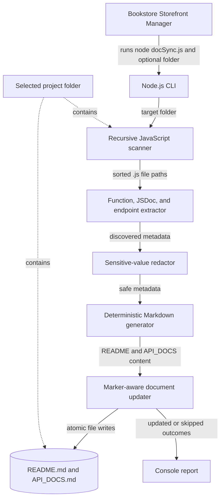
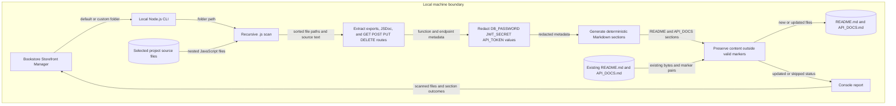

# Automated Documentation Sync Architecture

## Component diagram

## Data-flow diagram

## Design decisions

- The CLI runs locally with Node.js. `node docSync.js [targetFolder]` accepts an optional target; absent one, it scans `./bookstore-web-app`.
- Scanning is recursive for `.js` files and excludes `.git` and `node_modules`; sorted paths make output ordering deterministic.
- Extraction records exported or JSDoc-documented functions, their supported JSDoc details, and `GET`, `POST`, `PUT`, and `DELETE` endpoints.
- Generated sections update only between one valid `<!-- DOC-SYNC-START -->` / `<!-- DOC-SYNC-END -->` pair. Missing documentation files receive a title and marker pair; files with invalid markers are preserved and skipped.
- Password and API-key values for `DB_PASSWORD`, `JWT_SECRET`, and `API_TOKEN` are redacted before generated documentation or console reporting. No remote service is part of this flow.

## Interfaces

- **CLI:** `node docSync.js [targetFolder]`; optional folder path or repository-default `./bookstore-web-app`.
- **Inputs:** Nested `.js` source files in the chosen project folder; optional existing `README.md` and `API_DOCS.md`.
- **Outputs:** Generated function and endpoint sections in `README.md` and `API_DOCS.md`, plus a console report of scanned files and updated or skipped sections.
- **Internal boundaries:** Scanner returns sorted file paths; extractor returns function/endpoint metadata; generator formats Markdown; marker updater preserves human-authored regions and writes generated content.

## Failure handling

- A missing or non-directory target returns a clear error and non-zero status before documentation is changed.
- Read, extraction, generation, and write errors are reported without printing unredacted generated values. Generated contents are prepared before writes; each output file is written through a temporary file and rename.
- Missing, empty, or unreadable folders are handled with a clear report; an empty valid folder produces deterministic empty-section messages.
- A documentation file with a missing, duplicated, or reversed marker pair is left unchanged and reported as skipped. Failures do not trigger remote writes.
