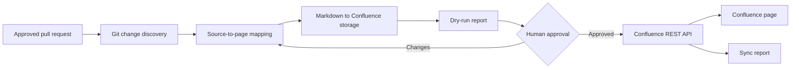
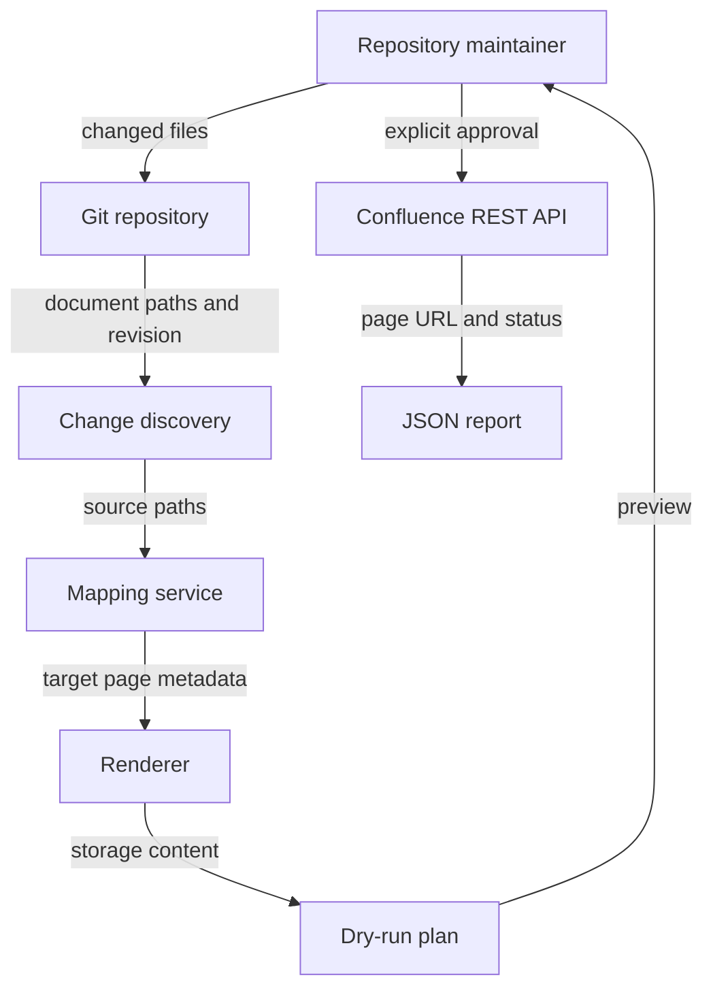

# Automated Documentation Sync Architecture

## Component diagram

## Data-flow diagram

## Components

- **Change discovery** filters Markdown files and produces a stable work list.
- **Mapping** resolves repository paths to Confluence page targets.
- **Renderer** converts Markdown content for Confluence storage format.
- **Confluence client** authenticates with `.env` or repository environment secrets.
- **Reporting** records source revision, target, status, and confirmed page URL.
- **HITL boundary** prevents writes and Git operations until the corresponding approval is recorded.

## Failure handling

Missing configuration and mappings fail before network operations. API failures return sanitized errors and non-zero exit status. Partial page outcomes remain isolated in reports.
