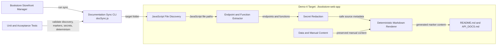
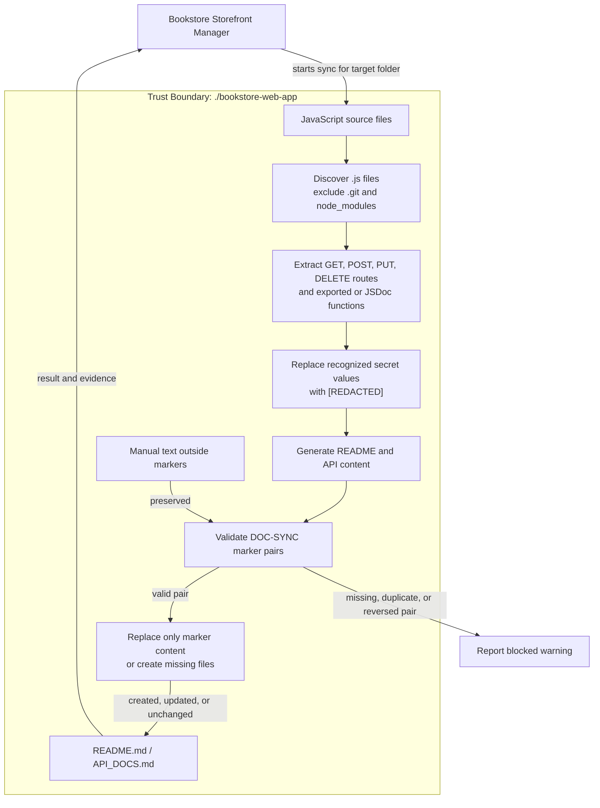

# Automated Documentation Sync Architecture

## Component diagram

## Data-flow diagram

## Design decisions

- **Fixed Demo-4 boundary:** The CLI accepts the repository-relative `./bookstore-web-app` target and discovers JavaScript files recursively, excluding `.git` and `node_modules`.
- **Safe extraction:** Supported HTTP routes are limited to `GET`, `POST`, `PUT`, and `DELETE`; JavaScript functions include exported declarations and JSDoc-documented declarations.
- **Deterministic rendering:** Source discovery and generated endpoint/function tables are sorted so unchanged inputs produce unchanged generated content.
- **Marker-based preservation:** Existing files are modified only between `<!-- DOC-SYNC-START -->` and `<!-- DOC-SYNC-END -->`; manual text outside those markers is not replaced.
- **Secret-safe output:** Recognized password and API-key assignments are redacted as `[REDACTED]` before generated documentation is written.
- **Atomic file updates:** New or changed content is written through a temporary file and rename to avoid exposing partially written documentation.
- **Output shape:** `README.md` contains the generated API overview with endpoint method, path, and source file. `API_DOCS.md` contains endpoint and JavaScript-function tables, including source file information.
- **Recognized secret assignments:** Detection and redaction cover password and API-key-style assignments, including the repository's configured `DB_PASSWORD`, `JWT_SECRET`, and `API_TOKEN` names; the key names remain present while only values become `[REDACTED]`.
- **Explicit status reporting:** Each document is reported as `created`, `updated`, `unchanged`, or `blocked` according to the existing marker and content state. A valid pair with byte-identical generated marker content is unchanged and is not rewritten. A missing, duplicate, or reversed pair is blocked and left unchanged.

## Interfaces

| Interface | Direction | Contract |
| --- | --- | --- |
| Bookstore Storefront Manager → Sync CLI | In | Run Demo-4 sync against `./bookstore-web-app`; no custom target in scope |
| Sync CLI → JavaScript sources | Read | Recursive discovery of `.js` files; exclude `.git` and `node_modules` |
| Extractor → Markdown renderer | Internal | Sorted endpoint records (`method`, `path`, `source`) and function records |
| Renderer → Documentation files | Write | Create missing README/API_DOCS files or replace one valid marker section |
| Sync CLI → Bookstore Storefront Manager | Out | Created, updated, unchanged, or blocked status plus actionable warnings |
| Unit tests → Sync CLI | Test | Discovery, extraction, markers, redaction, deterministic output, and error behavior |

## Failure handling

- A missing or non-directory target returns a non-zero exit status and an actionable error.
- An unreadable or malformed source area is handled as a sync failure with a sanitized error and no stack trace.
- Existing documentation with a missing, duplicate, or reversed marker pair is preserved and reported as blocked.
- Recognized secret values are redacted before parsing output is rendered or written.
- The update process cleans temporary files on write or rename failure and reports the sync failure.
- Repeated unchanged scans retain identical generated content and report unchanged results rather than rewriting documentation.

## Scope boundary

This architecture covers Step 2's Demo-4 documentation synchronization design only. It does not add Confluence publication, Git commit, pull request, or production application behavior. The repository's existing Confluence publisher is therefore not part of the active documentation-sync data path.
