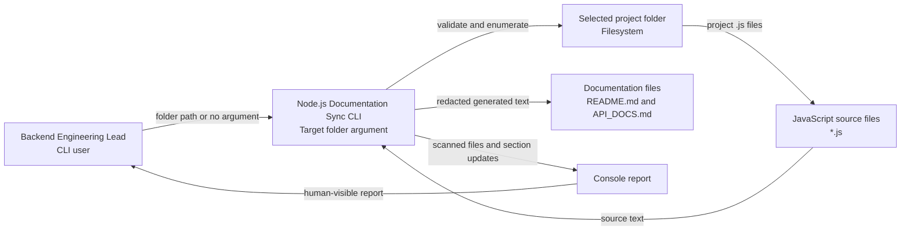
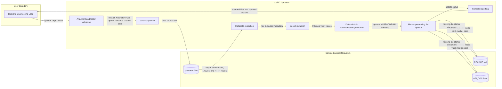

# [Demo-3] Automated Documentation Sync Architecture

## Component Diagram

## Data-Flow Diagram

## Design Decisions

- **Default target:** When no folder argument is supplied, the CLI selects `./bookstore-web-app`; a supplied path replaces that default.
- **Source selection:** Because the requirements identify `.js` files but leave nested-folder behavior open, the initial architecture treats direct `.js` files in the selected folder as the confirmed scope. Recursive scanning requires an explicit requirements change.
- **Extraction:** The CLI reads source text and derives exported functions, JSDoc comments, and route metadata for `GET`, `POST`, `PUT`, and `DELETE`. Exact JSDoc fields and route formatting remain open pending clarification and are therefore not invented here.
- **Marker preservation:** Generated content replaces only text bounded by `<!-- DOC-SYNC-START -->` and `<!-- DOC-SYNC-END -->`. Bytes outside a valid pair are not changed.
- **Missing documents:** Missing `README.md` or `API_DOCS.md` is created with a project-folder-based title and a valid marker pair, as required.
- **Existing documents without markers:** An existing file is not overwritten when it has no valid marker pair. The CLI reports a warning and skips the generated section; appending behavior is deferred until the open repair question is resolved.
- **Determinism:** Generated sections are derived in a stable order from unchanged source content so repeat runs produce the same result.
- **Secret boundary:** Redaction occurs before generation, documentation writes, and console reporting. No original secret value is stored or emitted.

## Interfaces

- **CLI input:** optional positional project-folder path; omitted value means `./bookstore-web-app`.
- **Source interface:** local reads of `.js` files in the selected target folder.
- **Documentation interface:** local reads and writes to `README.md` and `API_DOCS.md` in the selected target folder.
- **Marker contract:** both marker lines must exist and form a valid start/end pair before in-marker content is replaced.
- **Report interface:** local console text lists processed files and documentation sections updated, skipped, or created.
- **Representative redaction contract:** `DB_PASSWORD`, `JWT_SECRET`, and `API_TOKEN` values are represented as `[REDACTED]`.

## Failure Handling

- Missing or empty target folders return a clear report and non-exceptional CLI completion.
- Scan or generation errors stop document updates and return a clear error report.
- Documentation writes use a completed generated result followed by a safe local replacement strategy so a failed write does not leave partially written documentation.
- Read, parse, or filesystem failures identify the affected file or documentation section without exposing secret values.
- If a valid marker pair is unavailable in an existing document, the CLI skips that file and warns the user rather than damaging human-authored content.
- If a source or environment value contains one of the named secrets, no original value appears in generated docs or the report.
